# SketchDraw

`This app is made entirely using AI. Use at your own risk.`

SketchDraw is a desktop-first, offline-first design app for Windows, macOS, and Linux, with a lightweight Android companion. Its shared app shell routes to three separate workspaces: Canvas for drawings and diagrams (`.sketch`), Planning for notes and project records (`.sdplan`), and UI Design for interface mockups (`.sdui`). Each workspace keeps its own document session and data model, so you can switch between them without converting or merging files. Save locally or in a folder managed by OneDrive, Dropbox, Google Drive, or another sync service.

UI Design has a welcome screen with create/open actions, recent .sdui files, draft recovery, and a route back from the editor. Its contextual right inspector separates Design, Prototype, and Inspect; selection-specific controls stay with the selected layer, while the local token library remains in a distinct Design section. Its multi-page infinite canvas supports screen and container frames, shared nested layers with drag-and-drop stacking, before/after placement, grouping and ungrouping by reparenting, transparent groups, nested auto layout with fixed, fractional, and minmax grid tracks, editable responsive breakpoints managed alongside Frames in the Pages panel and side-by-side frame previews, local components with nested variants, master updates, and per-child overrides, mode-aware color/typography/spacing/radius/effect tokens with editable aliases across all token families and cycle-safe import validation, prototype preview, and SVG/PNG/PDF export. Inspect / Handoff provides SVG, PNG, multi-screen PDF, offline HTML presentation, token, accessibility-report, and CSS/HTML/SolidJS scaffold exports. The compact asset grid includes editable basics and searchable UI patterns, with component-library import/export. This workspace uses a separate .sdui version 1 format. Current limits include browser-level interaction coverage for nested components, advanced vector operations, and full multi-platform review. See the [UI Design development plan](docs/ui-design-development-plan.md) for verified behavior and the current backlog.

PlantUML imports and exports have documented editable subsets for activity, state, use-case, component, deployment, timing, mind map, WBS, Gantt, nwdiag network, JSON/YAML, and common ArchiMate declarations and relationships, alongside the existing class/object and sequence subsets. The editor shows supported syntax and known limits; advanced-family syntax errors include line and column information. Mapped text-label edits update retained source, while free canvas positions and added or deleted objects are not serialized.

**App versions: Windows 17.1.0 | Android 17.1.0 | Document format: v3 | Copyright (c) 2026 Toushal Sampat**

> SketchDraw saves version 3 .sketch documents for Canvas, version 1 .sdplan documents for Planning, and version 1 .sdui documents for UI Design. The UI Design parser rejects older or unknown schemas rather than silently migrating them. It reads version 2 sketches and migrates old Forms & UI component IDs and properties into the version 3 component record. Legacy .sketch versions 9 and 10 require confirmation before conversion; declining closes the source without saving. Earlier versions are unsupported. Canvas and Planning documents remain open when you switch workspaces. With a sketch open, a second navigation group switches between Canvas and Diagram tools within the Canvas workspace.

## Screenshots and previews

The launch and workspace SVGs are hand-drawn previews rather than runtime captures, so mobile tool visibility and spacing can vary with screen size. Board artwork and recent-file names are examples, not user data.

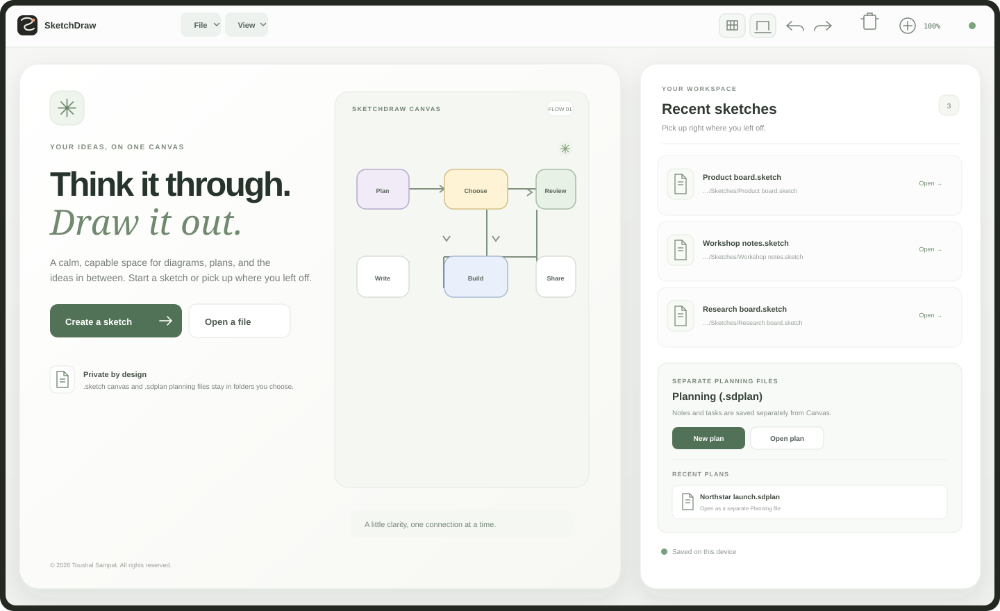

*Launch screen: switch between Canvas, Planning, and UI Design from the centered workspace tabs at the top of the welcome content. Each workspace opens and saves its own document format.*

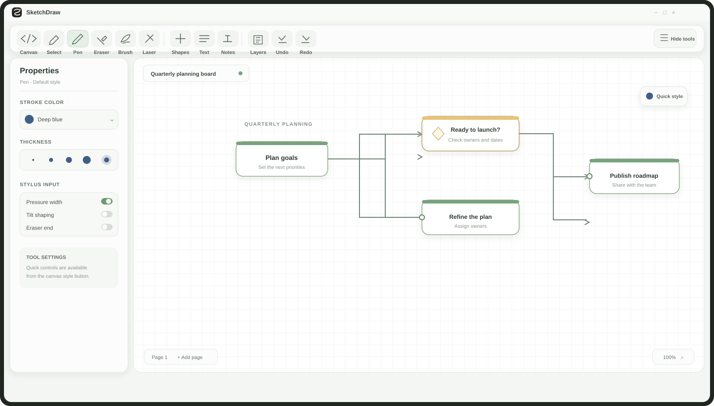

*Windows workspace preview: a flat, grouped toolbar, direct canvas actions, and a simpler contextual Properties panel.*

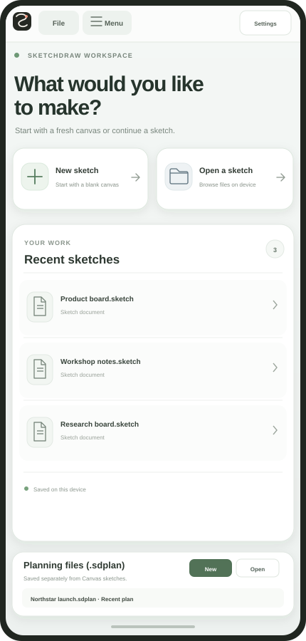

*Mobile home preview: use the header workspace switcher to move between Canvas, Planning, and UI Design. Each workspace keeps its own files and editing state.*

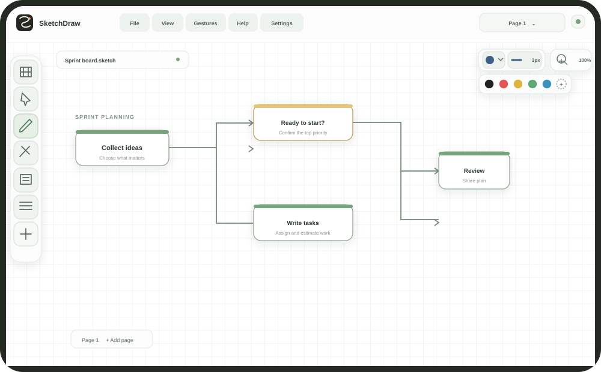

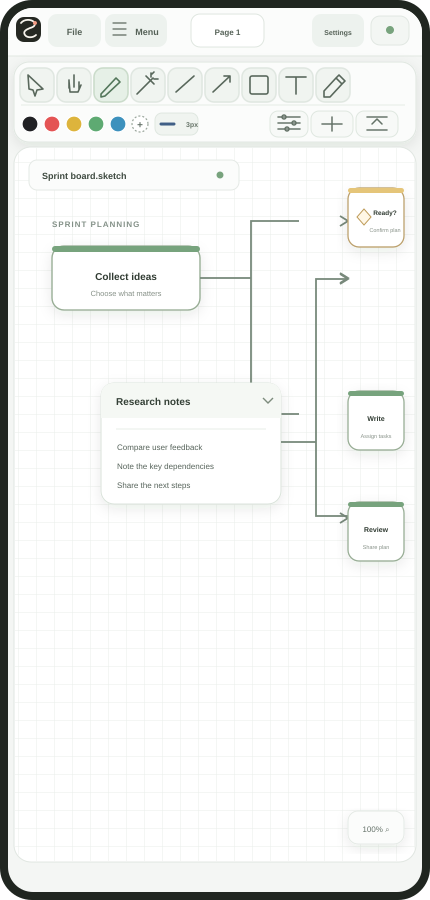

*Mobile and tablet workspaces: toolbars and quick-style controls stay separate and adapt to the chosen toolbar position and screen orientation. The full Properties pane stays attached to the left edge, sizes to the available screen height, and leaves a gap below it. Choose an orientation and toolbar location in App Settings on supported devices.*

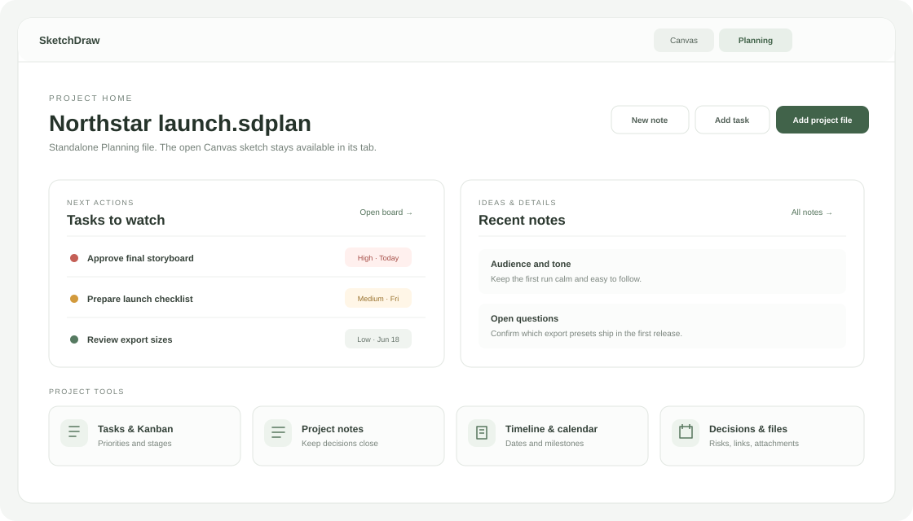

*Planning Home for the standalone `Northstar launch.sdplan` file. Switch to the Canvas viewport to return to the still-open whiteboard; saving Planning updates the separate `.sdplan` file.*

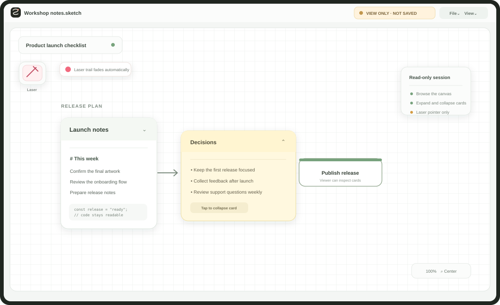

*View-only preview: inspect a `.sketch` file with the laser pointer while expanding or collapsing note, sticky-note, and checklist cards.*

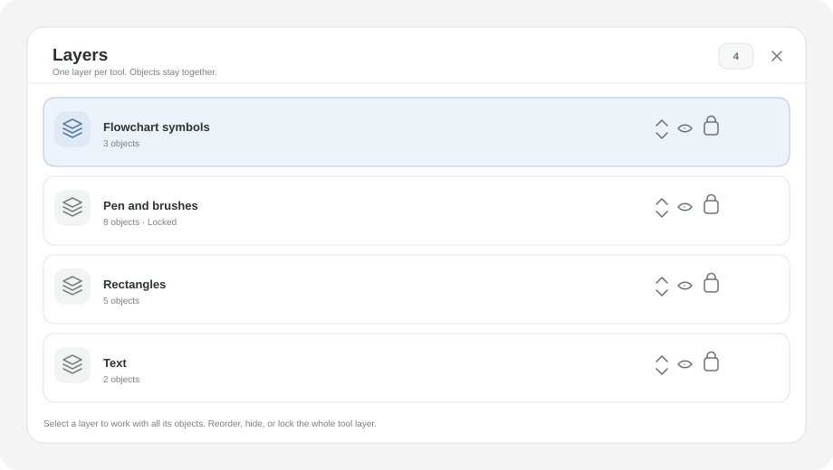

*Layers group objects by tool by default. Create a named layer from a selection when you need to organize objects across tools.*

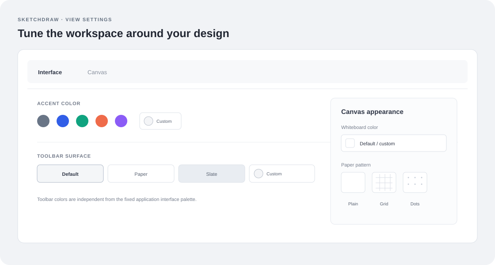

*View settings preview: adjust interface accents and toolbar surfaces, then customize the whiteboard separately.*

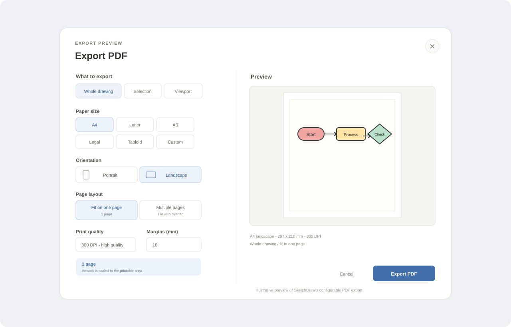

*PDF export preview: standard paper sizes, custom dimensions, portrait or landscape, fit-to-page or tiled pages, overlap, margins, and print quality.*

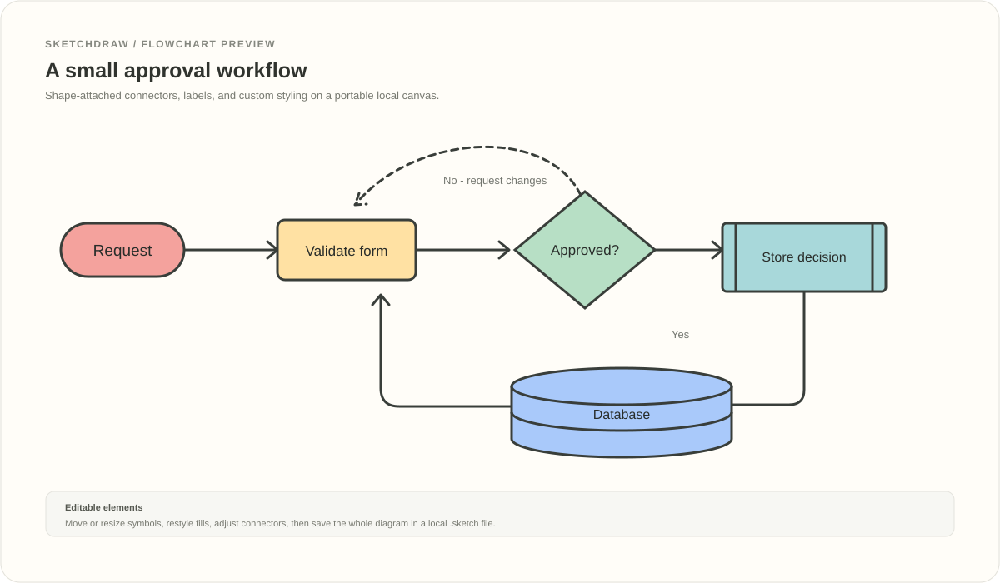

*Diagram preview: editable flowchart shapes, labels, filled symbols, and attached connectors.*

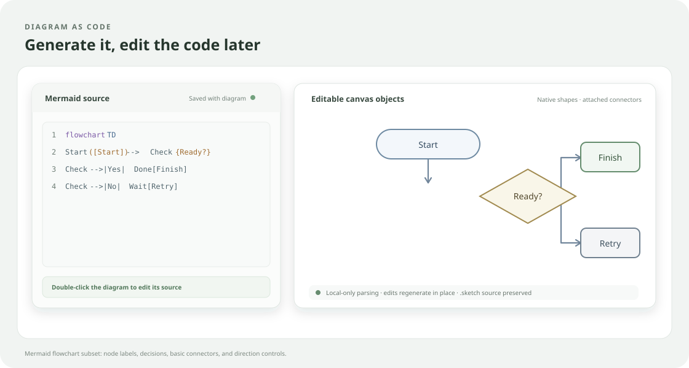

*Diagram as code: generate editable Mermaid flowcharts, swimlanes, Event Modeling timelines, Cynefin maps, Wardley maps, and other supported diagram families and keep their source with the group for later editing. Mermaid, DOT, CSV, and a PlantUML subset can import or export editable diagram data; BPMN 2.0 XML imports editable process nodes and relationships while retaining process metadata, unsupported source XML, and diagram information for export. SQL and JSON Schema can generate editable database table cards and be exported again.*

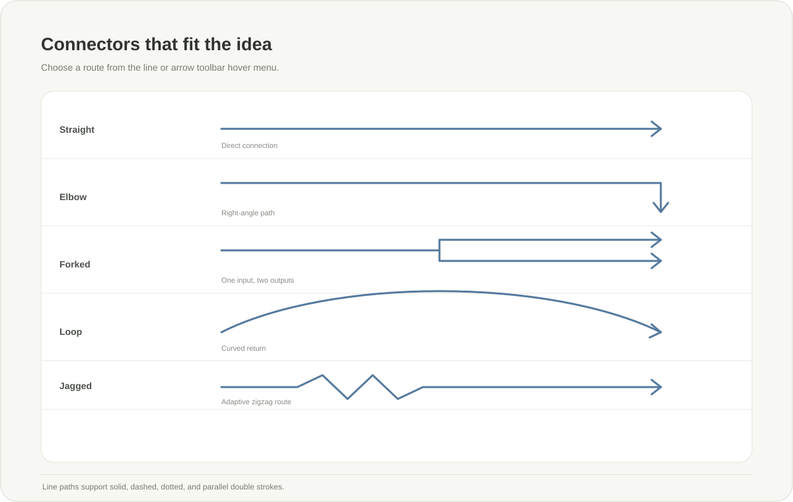

*Connector examples: straight, elbow, curve, and forked routes, plus varied line styles.*

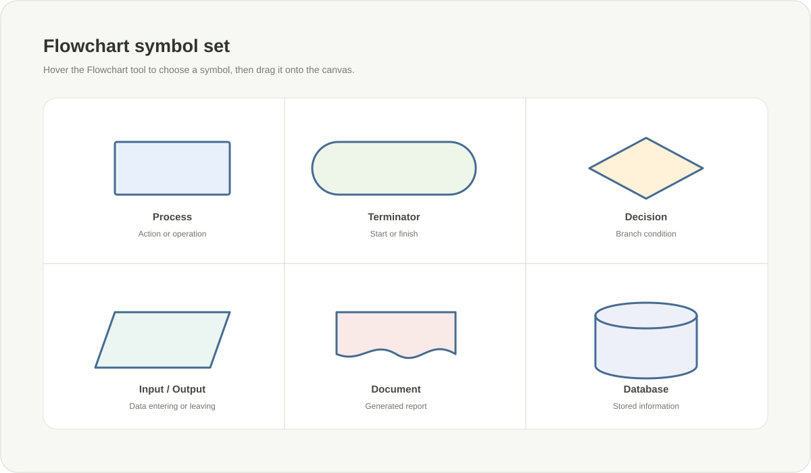

*Flowchart symbol gallery, including database, decision, document, and process symbols.*

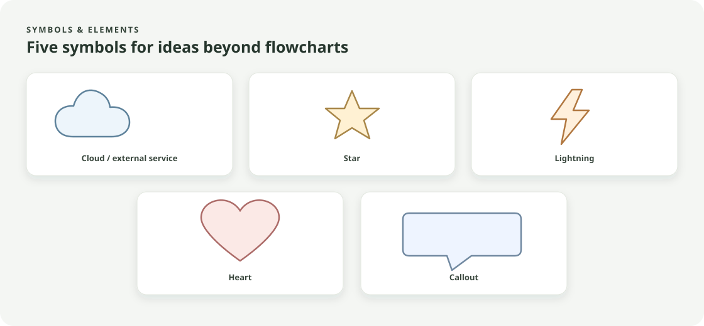

*The flowchart palette includes cloud, star, lightning, heart, and callout symbols.*

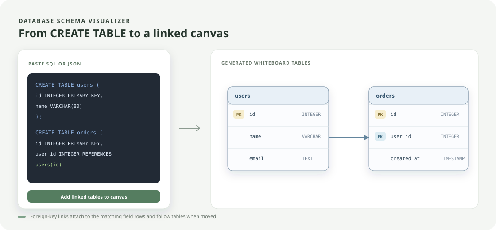

*Paste SQL `CREATE TABLE` statements or JSON Schema and generate editable table cards with key links attached to field rows.*

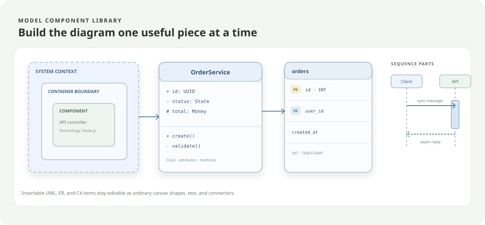

*Insert individual class, sequence, ER, and C4 architecture components instead of a prefilled diagram.*

*Built-in modeling cards resolve their stable type from the component library. Older child-drawn cards are upgraded when opened, keeping their instance bounds, labels, fields, and connections while using the current renderer.*

*Modeling components use a shared geometry contract for their visible outline, label area, resizing limits, and connector ports. Their full details stay visible at every zoom level. Component exports use stable text baselines and deduplicated SVG symbols; `.sketch` v3 files store Forms & UI values in a versioned nested record while loading older version 2 component values through migration. See [the component rendering contract](docs/component-rendering-contract.md) for geometry, port, size, cache, and compatibility details.*

*The cloud library includes compact provider-neutral service symbols alongside AWS, Azure, and Google Cloud cards with provider artwork. Neutral symbols use the open-source [Material Design Icons](https://github.com/Templarian/MaterialDesign-JS) paths, with editable resource, location, and configuration fields. The neutral catalog includes Kubernetes workloads, enterprise integration patterns, compute, networking, data, security, platform, and operations services.*

*Object alignment guides identify the reference component and show a short line between the aligned shapes with anchor dots. Center matches are preferred when several edges are equally close, keeping chained component layouts aligned.*

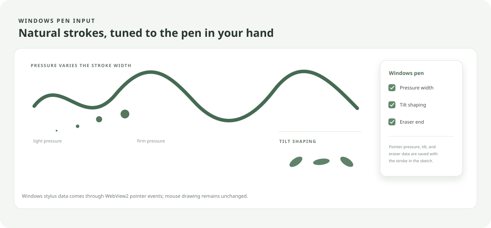

*Compatible styluses can provide pressure, tilt, and eraser-end data through platform pointer events.*

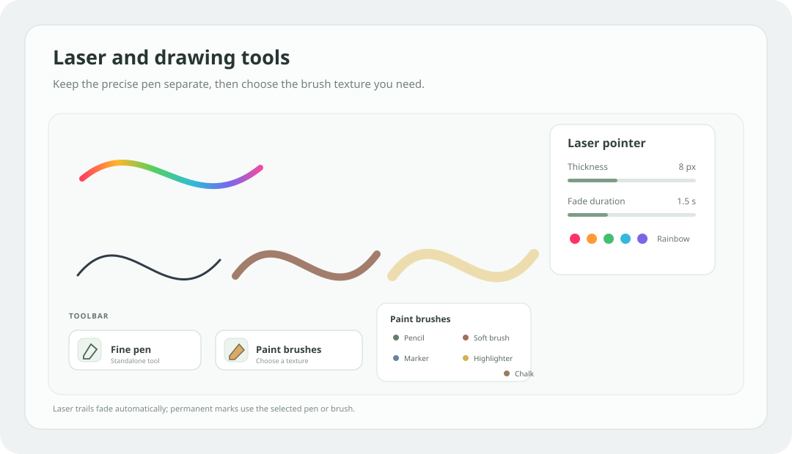

*The Pen icon selects the fine pen directly. A separate Paint brushes icon opens pencil, soft brush, marker, highlighter, and chalk; the pen thickness setting applies to all six drawing styles. Laser settings control line thickness, fade duration, color, and rainbow trails.*

*Modeling cards use the selected component treatment; graphs keep their modern visual style. Text cards use the same compact boundary style across themes.*

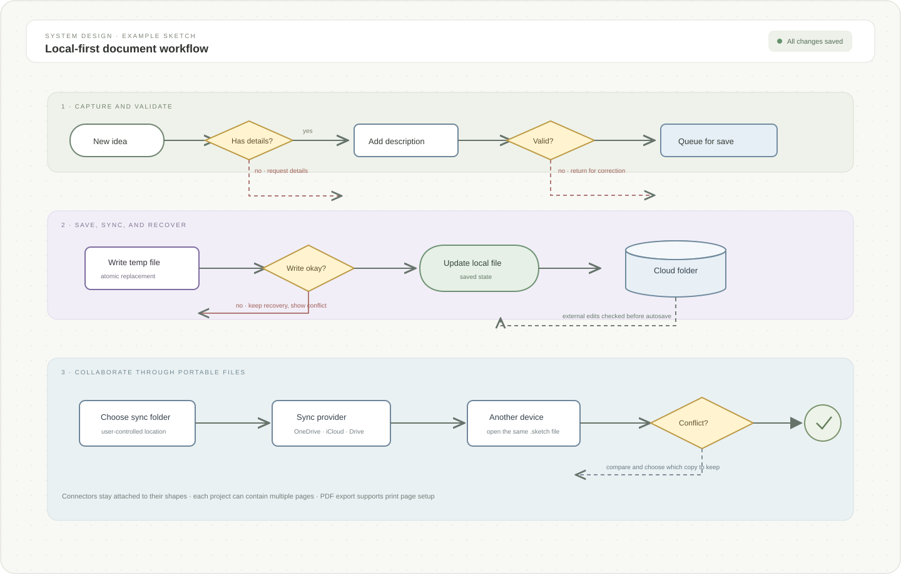

*A larger example combines decision branches, database storage, retries, attached connectors, and multi-stage process lanes.*

## Features

- **Quick text styling:** Adjust text size from the quick-style rail, then open its text-style popover for Bold, Italic, Underline, and all six supported font families.
- **Text wrapping:** New and edited canvas text wraps within a 240-unit text box; shape and connector labels wrap to their available label area. Editing, selection bounds, canvas rendering, and SVG/PDF export share the same wrapped lines.
- **File menus:** File holds sketch and plan create, open, save, rename, and close actions. The separate Import / Export menu groups image, PDF, draw.io, editable diagram/code, web embed, and document export actions.
- **Keyboard shortcuts:** On Windows, Help and F1 open one searchable shortcut view with editable assignments and fixed shortcuts together. Other platforms keep the reference-only shortcut list.
- **Precision tools:** Use **M** to measure between selected canvas objects or drag between two canvas points; the object measurement shows axis gaps, nearest distance, alignment, and equal spacing. **Escape** leaves measure mode. Snapping uses the configured grid, object alignment, equal-spacing targets, and one-pixel free-move/resize precision; hold **Ctrl** or **Command** to bypass snapping, and hold **Shift** to constrain movement to one axis, release resize snapping and aspect locks, or constrain line and arrow angles in 45-degree steps. While drawing or dragging a connector endpoint, near-horizontal or near-vertical alignment snaps to the fixed endpoint's axis and shows a temporary guide. Select an SVG path or freehand stroke to move or delete nodes; SVG node editing supports simple move, line, and close paths. The inspector offers stroke cleanup for near-rectangles, ellipses, lines, and arrows.
- **Document workspaces:** Canvas, Planning, and UI Design are independent workspaces with separate document sessions, models, routes, and formats: `.sketch`, `.sdplan`, and `.sdui`. The centered workspace tabs appear at the top of the desktop welcome content and in the compact workspace header while a document is open. Within an open sketch, a second tab group selects Canvas or Design diagrams in that same `.sketch` document. Windows tabs can switch between open sketches or plans and close them, saving pending changes before a document is replaced or closed. Create or open each format from its workspace, and open registered `.sketch`, `.sdplan`, or `.sdui` files directly from Windows or Android.
- **Project planning:** Keep project notes, prioritized and dated tasks, task checklists, dependencies, milestones, decisions, risks, links, and attachments in a `.sdplan` file. Start notes from Design brief, Requirements, User interview, Meeting notes, or Architecture decision templates. Use the Kanban board, drag tasks between stages, reorder cards, and review dates in Timeline or Calendar. Planning Home includes a task burndown and a count of tasks completed in the last week.
- **File updates:** On Windows, file-watch events detect outside changes to an open `.sketch` file, with a 30-second polling fallback for cloud folders and removable drives. Independent Canvas page and object edits can merge after a provider syncs the changed file; conflicting edits use edit clocks. `.sdplan` files are saved with a baseline check to detect external changes, but they do not use the Canvas background watcher or merge. Android document-provider files do not use background polling. SketchDraw does not host files or live collaboration.
- **Drawing tools:** Click Pen to select the fine pen directly. The separate Paint brushes icon opens Pencil, Soft brush, Marker, Highlighter, and Chalk. Set pen and brush thickness to use presets or fine adjustment; both options work for every drawing style in Properties too. Use a temporary laser pointer, create and fill geometric shapes, crop imported images, and adjust stroke, fill, opacity, corners, and text styling. In full Properties, stroke controls come first, fill type/color/opacity stay together, then shape, label, and text settings follow. The quick-style rail stays hidden when Select, Pan, or Crop is active without a selection. Open Properties to replace the rail with the full inspector for detailed object styling and connector routing.
- **More Tools and toolbar layout:** Fill bucket, Measure distance, Crop image, Edit selected path nodes, Create frame from selection, Code & data, and Paint brushes can be moved between the toolbar and **More Tools**. The More Tools panel keeps a fixed width when brush choices expand. Pen, Brushes, and Eraser stay in sequence when Brushes is on the toolbar; More Tools stays after the stencil library and before history actions. Open **Customize toolbar** to reorder tools, move eligible tools between lists, or hide Undo and Redo; the layout is saved locally.
- **Flowchart symbols:** Build diagrams with process, terminator, decision, input/output, document, multi-document, database, internal storage, preparation, manual input, merge, extract, collate, sort, junction, loop, display, and data-storage symbols. Decorative and general-purpose shapes such as clouds, gears, stars, and crosses are grouped under General. All existing saved shape values remain supported.
- **Shapes palette:** Rectangle, circle, and diamond stay on the toolbar; Triangle is available in Shapes under Basic. Search and switch between Basic, Common, Other, General, or All. The Windows Shapes tool includes Flowchart and General catalogues plus a footer action to spawn every shape on the canvas; phones and tablets keep the basic shape picker compact. The General catalogue includes block arrows, ring, pie slice, wave, banner, teardrop, and funnel. Palette icons, canvas outlines, connector snap points, hit testing, and vector export share proportional shape geometry. Select a block arrow to drag its head-length and shaft-width handles; stars, hexagons, octagons, trapezoids, preparation shapes, and rounded rectangles expose a contour handle. Selection and hover do not add a second contour around an object; resize and rotation handles remain available. Shapes and text render as vectors. Zoomed-out scene tiles and modeling-component bitmaps are used only when they can be copied onto the canvas one-to-one at physical-pixel alignment; other views draw directly to the canvas.
* **Shape and component references:** The short catalog is in [`docs/shape-and-component-names.md`](docs/shape-and-component-names.md). The generated [`docs/shape-component-geometry.json`](docs/shape-component-geometry.json) provides normalized primitive paths, component coordinates and child elements, editable fields, default connection ports, and rendered component SVG. Run `npm run reference:shapes` after changing the shape or component source definitions.
- **Modeling palette:** Keep Basic shapes, Connectors, Flowchart, and Database as separate sections; consolidate the remaining diagram components into UML, BPMN, Architecture & software, GUI design, cloud, network, planning, visualization, and structure/annotation groups. These categories add 198 proposal components; the four items already in the library remain in their existing categories. Systems engineering and advanced UML is complete with dedicated SysML/UML fields, typed relationship details, interface ports, resize rules, canvas rendering, and SVG export. BPMN and decision modelling is complete at the component level: event and subprocess symbols, choreography and collaboration nodes, BPMN data elements, DMN decisions and services, typed relationship directions, editable decision tables, validation, and sequence simulation are implemented with canvas and SVG layouts. Database and software architecture families are complete with purpose-specific fields and canvas/SVG symbols for schemas, data stores, lineage, APIs, events, sagas, resilience patterns, domain models, business roles, and technology nodes. the visual planning family now has dedicated editable layouts and calculations for maps, scoring and prioritization matrices, RACI, decision trees, customer journeys, empathy maps, service blueprints, event-storming, impact and story maps, roadmaps, WBS, objectives and key results, and critical-path scheduling with typed dependencies; wireframing now has dedicated editable layouts for device frames, navigation, overlays, loading and error states, editors, validation, search, and accessibility patterns, with responsive viewport presets and usable resize bounds. Search still spans every category. Existing UML, entity relationship, cloud, Kubernetes, network, and diagram basics remain available in their own categories.
- **BPMN XML:** Import `.bpmn` and `.bpmn2` process XML or export a page or selection as BPMN 2.0 XML. Editable nodes, lanes, sequence/message/data relationships, labels, stable semantic IDs, and the primary diagram bounds round-trip through the canvas. Definitions, process and collaboration metadata, namespaces, extensions, nested lane membership, and multi-endpoint data associations are retained. Unsupported BPMN elements and relationships without editable endpoints remain as original XML and appear in the compatibility report with kept, simplified, and skipped counts. Additional BPMN diagram planes are preserved as source XML; the first plane supplies editable canvas geometry.
- **ER and UML notation:** ER symbols default to black outlines and text on white fills; change their appearance through Quick Style or Properties. Simple symbols such as use cases and state markers keep their standard geometry and contour-aware hit testing.
- **Diagram guides:** Open **Diagram guides** from Canvas Help to browse 46 editable examples across flowchart, UML, ER, BPMN, C4, network, cloud, brainstorming, user journeys, API, data flow, DevOps, operations, and security. Examples include mind maps, use cases, C4 container and dynamic views, Kubernetes clusters, data pipelines, incident response, decision trees, API authentication sequences, Git workflows, and CI/CD pipelines. Workshop templates include retrospectives, SWOT, affinity and empathy maps, lean canvases, kanban boards, weekly planners, fishbone analysis, and icebreaker grids. Diagram types include Venn, pyramid, cycle, matrix, timeline, roadmap, Gantt, sitemap, wireframe, floor plan, server rack, and logic-circuit examples. Search by topic, then follow each guide's level, estimated time, modeling steps, good practices, common pitfalls, related guides, and source links. Previews and inserted examples use the same calculated layout; inserted connections stay attached to their shapes when moved.
- **Connectors and line styles:** Draw straight, elbow, or curved lines and straight, elbow, curved, or forked arrows. Curves start with a visible bend and one editable control point; add or remove equally spaced points from the route menu. Connectors bind to named north/east/south/west ports or custom connection points on shapes and components, and update when targets move or resize. Custom ports can restrict accepted relationship types; incompatible saved bindings appear in validation, and endpoint dragging skips incompatible ports. Apply solid, dashed, dotted, or double strokes to connectors, shapes, containers, and GUI component outlines. Choose arrowhead styles, drag route handles, enforce elbow-only routing, and reattach nearby dangling endpoints in bulk. Automatic obstacle routing and route optimization use shared diagram geometry on desktop and mobile.
- **Connector editing:** Auto-routed bends can be pinned as waypoints and remain attached to the route as nodes move. Endpoint and bend edits reroute the active automatic connector live; other routes stay stable during a drag and retain plain crossings when they meet. Add multiple labels to a connector, drag a label to position it freely, hold Alt while dragging to slide it along the route, and edit labels in place. Dragging the connector itself moves the whole connector. Start a connector at a node port and release on empty canvas to create a connected node. Forked arrows support one trunk and two destinations. SQL foreign-key links attach to their key rows and route as a set to reduce overlapping paths.
- **Find and replace:** Press **Ctrl+F** to search labels, notes, components, and table names across every page. Open a result to navigate to its page, or replace every matching occurrence inside that object; each object edit remains undoable in its page history.
- **Interactive prototypes:** Link an object to a page and choose an instant, fade, or slide transition in its properties. **Run prototype** in the history toolbar group starts a temporary, interactive preview: click built-in form controls to change their runtime values and click linked objects to navigate between pages. Stop the run to restore the original canvas values; prototype interactions do not save or add undo history. Presentation mode can also follow links with transitions and present frames as screens.
- **Forms & UI:** Open the searchable component library from the **Components** tool after Text in the toolbar; hover or click to open its floating panel. Customize its position with the toolbar organizer. Canvas Options and the command palette provide the same entry. The compact library has filters for each diagram and Forms & UI section, plus custom stencils and reusable document components. Its 32 Forms & UI components include fields and controls, cards, app bars, navigation, lists, tables, accordions, menus, feedback, pagination, dividers, and footers. Select an inserted component to edit its title, placeholder, options, navigation items, and content in the inspector. Create named screen frames, reusable components, arrange a selection, present frames, or export a selected screen.
- **Frames and containers:** Create named frames from a selection, move their contents together, fit bounds to content, reorder frames, and choose clipping, auto-resize, or a locked size. Groups and containers own their children, including frames and swimlanes. Swimlanes support 2–8 lanes, draggable dividers, lane reordering, and moving lane contents while bound connectors stay attached. New groups have no border or title by default; toggle either in the quick-style bar or properties. Set the border color, style, and thickness from quick styles or properties. Resizing a group scales its child objects together. Use the component editor to reparent selections and edit custom connection points.
- **Selection and layers:** Move, resize, rotate, group, duplicate, align, and distribute objects. Ctrl/Command-click objects to add or toggle them in the current selection; click empty canvas with the modifier to add a marquee selection. Align selected nodes by connector flow to arrange dependency levels into columns. Collapse a container into a compact item-count summary and expand it without changing its contents. Select connected or similar objects from the command palette. Create per-page layer trees, nest or unnest layers, move selections between layers, and hide, lock, reorder, rename, or delete layers. Save named visibility presets on each page to switch between current and future states. Objects are grouped by drawing tool by default. Resizing a group scales child geometry while keeping line and arrow stroke widths fixed. Undo and redo history is kept per page for the current session.
- **Canvas navigation and snapping:** Pan, zoom, fit the full drawing, or zoom to a selection. Set the board color and paper pattern, use grid and object snapping together, and open Canvas options for an optional minimap and pen input settings. Grid snapping follows the visible paper spacing, including half-size subdivisions on small-grid and small-dot paper, at every zoom. Grid snapping takes priority over the default 10-unit move snap; nearby object alignments take priority over grid snapping and show temporary guides while moving or resizing. Hold Ctrl/Command while dragging to bypass snapping. Basic shapes have a 25 × 25 unit minimum; connector width and height show the actual endpoint distance, so one, two, and three grid segments read 25, 50, and 75. The toolbar and quick-style bar stay in their normal positions. Automatic layout is available on desktop and mobile; touch layouts keep advanced tools under More canvas tools, including the spacing control for automatic layout.
- **Pages and project files:** Keep up to 100 named Canvas pages in a compact version 3 `.sketch` file. Planning records live in a version 1 `.sdplan` file; up to 100 recent plan paths are remembered separately from up to eight recent sketch paths. Recent sketch entries are deduplicated across Windows extended-path forms and shown with readable names and locations. Legacy version 9 and 10 sketches can be converted after confirmation; version 2 sketches are read and migrated in place. The replacement keeps canvas pages and moves/removes retired notebook and Library records according to the confirmation flow. Rename a sketch from the File menu; the open document, tabs, recent list, and autosave follow its new name. Autosave runs at the chosen 5- or 10-second interval, and Canvas recovery can restore interrupted edits. Desktop SketchDraw archives clean open sketch and Planning documents weekly in app-local `.sdbackup` storage and prunes archives older than 30 days; Android does not create these archives.
- **Text and note cards:** Hover over the Text tool to open plain text, Markdown, table, code note, sticky note, and checklist modes. Markdown, sticky-note, and checklist text support bold, italic, underline, highlight, strikethrough, and inline code from the editor toolbar; Ctrl/⌘+B, Ctrl/⌘+I, and Ctrl/⌘+U apply the first three styles. Paste or edit checklist text in the side-panel textarea, with one task per line, `# Heading` for a section, `- [ ]` or `- [x]` for a task, and indentation for nesting. Legacy `**Title**` headings and `✓ ` completed tasks remain accepted when pasted. Standalone Markdown tables appear on the canvas as a table only, without a note background, title, or collapse control. Use the dock to edit cells and add or remove rows and columns, or switch to Markdown source. Other note cards fit their content and can be resized or collapsed. Older default-sized cards are fitted when opened. Small resized diagram components remain safe to draw and export.
- **Diagram as code:** Paste Mermaid flowchart, swimlane, Event Modeling, ZenUML, sequence, class, ER, state, use case, Ishikawa, TreeView, Cynefin, Wardley, journey, Gantt, C4, mind map, timeline, Git graph, requirement, quadrant, Kanban, Sankey, block, pie, XY chart, radar, treemap, Venn, packet, or architecture diagrams, preview them, and generate editable shapes, chart data, and attached connectors. The Mermaid help panel shows the active family’s supported subset and known losses. Swimlane subgraphs become editable responsibility frames with bound, labeled handoff links; supported lane direction and Mermaid frontmatter/accessibility metadata are retained on export. Pie, XY, and radar chart data stays editable in native chart components; treemap hierarchies become editable nested rectangles; Venn sets, unions, and nested text labels become editable objects with approximate size-scaled circles; Ishikawa indentation becomes a fishbone with editable cause branches and an editable spine; TreeView indentation and box drawing become editable file/folder rows, bound hierarchy links, descriptions, highlights, and icon fallbacks; Cynefin creates five editable framework regions, item badges, transition arrows, wavy domain boundaries, and a central confusion region; Wardley maps render editable value-chain components, anchors, strategies, evolution positions, and bound dependencies; Event Modeling maps compact and relaxed timeframe declarations into editable lanes and cards, with inferred and explicit relationships and editable data examples; ZenUML supports editable participants, synchronous and asynchronous messages, calls, replies, and control-fragment frames. Mermaid styling and click directives outside the swimlane subset are reported as unsupported. A persistent source editor appears for selected generated diagrams; it can preview, regenerate with a layout warning, update source from canvas, and copy the code. Mermaid and PlantUML groups keep their source for later editing. Mermaid flowchart imports preserve common node/link styles and subgraph grouping; Mermaid and PlantUML sequence imports support participants and common message arrows. Sankey imports preserve weighted flows; block imports support grid columns and spanning blocks. These are supported syntax subsets, with unsupported constructs reported instead of silently dropped. PlantUML class/object import and export remain a supported subset. Import supported Mermaid, DOT, D2, CSV, and PlantUML subsets from files. Export editable diagram labels and relationships as Mermaid, DOT, D2, CSV, or PlantUML. D2 imports nested containers, SQL table cards, editable UML classes, simple sequence participants and messages, common shapes, supported styles, near hints, direction, grid dimensions/gaps, and padding. Source IDs and modeled styles survive `.sketch` normalization and D2 export/reimport. Near positions use SketchDraw's approximate layout; icon URLs are kept as metadata without network fetching or image rendering, and D2 has no documented `far` placement attribute. Sequence fragments and unsupported D2 properties are rejected with source locations.
- **Code & data tools:** One toolbar entry opens Mermaid and PlantUML generation, CSV charts, schema visualization, and code/data import and export. Use **UML class diagram** to start with editable class cards and bound relationships, then edit attributes and methods in the component editor or reopen the saved Mermaid/PlantUML source. Mermaid and PlantUML class source files also import as editable class diagrams. Direct SQL connections remain unsupported. Export Java or Python starter classes from UML cards, or a Prisma schema from database cards, as a local ZIP. Mermaid, PlantUML, and schema editors show format guidance from an info button. Generated diagrams and simple table-style schema cards keep their source for later editing; selecting a schema card opens its source and live preview in the left panel. The schema editor can be collapsed to a small reopen button, resized from its right edge, and set to wrap or not wrap text; its width is remembered locally. Schema cards can resize to a compact width, shortening long labels to fit. CSV charts can be edited later from the chart itself, updating that canvas object. Source panels accept pasted text or local files. SQL transformation scripts, Airflow DAGs, and GitHub Actions workflows import as editable graphs without executing their source.
- **Design workspace:** Switch from Canvas to Design to open a searchable, scrollable shape palette that shows categories and subcategories directly on the main panel. Subcategory headings are all visible and their contents are collapsed on first open; expand sections individually or all at once from the palette heading. Search opens matching sections in place; there is no parent-category drill-in. Search filters the sections and items in place. Each modeling component appears in one deliberate group; database services stay with their software or cloud families, while the Database group contains ER symbols, schema tables, views, indexes, and stored procedures. Palette items use compact icon-and-label tiles, with AWS, Azure, and Google Cloud entries showing their modeling component previews; section headings stay visible while scrolling; the mobile palette docks to the left edge and hides its scrollbar. Basic shapes includes primitive and decorative shapes. Connectors includes straight, elbow, and curved lines, solid, dashed, dotted, and double strokes, plus open, filled, two-way, dashed, and dotted arrows used across diagram families. Diagram structure includes reusable frames and swimlanes. Architecture includes C4 people, software systems, external systems, deployment nodes, container and component elements, and enclosure boundaries. UML includes object instances and activity actions, decisions, initial nodes, and final nodes alongside classes, sequence symbols, state machines, and relationships. BPMN includes group artifacts, events, tasks, gateways, data objects, and pools; shared connector presets cover sequence flow, message flow, and data associations. The Design toolbar includes the Canvas view menu for fitting the drawing or selection and changing grid and snap options. Click a shape to add it to the current `.sketch` page. Double-click text or a shape label to edit it on the canvas; select any labeled shape or component to apply font size, family, emphasis, color, alignment, and paragraph formatting directly from the Design toolbar without opening text edit mode. On touch devices, vertical tool layouts place this formatting strip beside the rail with horizontal scrolling. Schema import and export remain in Code & Data, and selecting a schema card opens its source in the left panel for live SQL or JSON edits. The palette or editor stays isolated from the object inspector and can collapse to a reopen arrow. Position and size controls live in a collapsible section in the component editor dock, and expanded editor sections retain their state while the selection updates. Grouped objects keep a tight selection boundary. Switch between Canvas and Design without changing the document.
- **Grouped editing:** Double-click a plain group to edit its contents in place. Other canvas objects remain visible, new objects become part of the active group, and a group boundary plus status label show the current edit scope. Press **Esc** to return to the parent group or full canvas.
- **Database schema visualizer:** Paste PostgreSQL, MySQL/MariaDB, SQLite, or SQL Server DDL, JSON table definitions, or JSON Schema object definitions to create editable table, view, and PostgreSQL enum cards. The editor accepts source files up to 5 million characters and uses one visible native text area for editing, with scrolling and wrapping kept in that same layer; the sidebar includes a wrap toggle. Each generated diagram supports up to 50 schema objects and 100 columns per object. SQL parsing retains qualified object names, common column/table keys and constraints (including foreign-key update/delete actions), indexes, view queries, and enum values. Table cards show field-bound relationships; view and enum cards carry a visible kind badge. Selecting a schema card opens its saved source in the left panel; edits update linked cards and the canvas preview as you type, with one undo step for the editing session. SQL export lets you choose PostgreSQL, MySQL, MariaDB, SQLite, or SQL Server and lists known dialect losses before saving. Named enums become inline `ENUM` columns for MySQL/MariaDB, text columns with `CHECK` constraints for SQLite/SQL Server, and remain native types for PostgreSQL. Draft 2020-12 JSON Schema export uses SketchDraw extensions to retain SQL types, schema object kinds, view queries, and key metadata. The visualizer imports schema text; it does not connect to a live database. Modeling components also cover document, graph, vector, event, Avro, Protocol Buffers, GraphQL, relational constraints, warehouse, lineage, data contract, classification, and quality models; their editable fields appear in canvas and SVG renderings.
- **Modeling components and graphs:** Insert editable UML, sequence, ER, C4, cloud, software, BPMN, and network shapes, plus general-purpose frames and swimlanes. UML includes object instances, activity actions and decisions, activity initial/final nodes, state-machine nodes, component, deployment-node, artifact, and enumeration symbols; BPMN includes message, timer, error, signal, and terminate events, user/service/script/call activities, data stores, annotations, group artifacts, sequence flows, message flows, and data associations; network includes proxy, bridge, bastion, gateway, printer, and workstation. C4 includes people, software systems, external systems, deployment nodes, container elements, and component elements alongside explicit system and enclosure boundaries. AWS, Azure, and Google Cloud libraries include common compute, storage, database, messaging, security, and network services. Provider symbols show labels and readable icon fallbacks while their provider glyphs load, and retain provider artwork in SVG export. Network symbols include gateways, DNS, VPN, internet, modem, and wireless access points; BPMN includes boundary and event gateways and subprocesses. Use **Spawn all components** to place a neatly spaced, labeled specimen sheet on the canvas. Component text uses consistent per-cell positioning and compact sizing across Canvas and SVG so labels stay inside their own boxes without overlapping adjacent content. The component editor dock starts collapsed, remembers its open or closed state across selections, and can be resized from its visible side handle or with the arrow keys; its width preference is saved locally. The dock keeps named connection point editing, page links, and nested diagrams together, with page navigation collapsed until opened. Connector snap handles are spaced consistently across each shape’s visible outline, keep standard side ports centered, and use custom path contours for irregular shapes. In **Run Prototype**, link a selected object to another object on the same page to move the canvas focus through a multi-component flow; page links can still open other pages, and form controls run with temporary values. Stopping restores the original canvas view and component values. Links inside grouped objects can be opened directly from the selection. BPMN flows support conditions and default paths; the token simulator follows parallel paths through gateways and waits at modeled joins. Diagram checks include general, BPMN, and ERD profiles. Editable charts include bar, horizontal and stacked bar, line, area, scatter, pie, doughnut, radar, gauge, funnel, heatmap, treemap, and metric cards. Paste CSV into a chart wizard to map label and numeric series columns, or create a chart from schema table metadata or a Markdown note table. The chart editor includes a multi-series data table, row and series controls, CSV import/export, per-category and per-series colors, mixed series types, primary and secondary axes, annotations, palettes, legends, axis controls, and display settings. Chart value edits update the graph while typing. Charts use Apache ECharts for consistent rendering on canvas and SVG export.
- **Wireframing and UI planning:** Add 24 editable screen, navigation, overlay, loading/error, form, search, editor, and accessibility components. Edit content and behavior fields in the component inspector, use responsive viewport presets on device and window frames, and resize each object without shrinking below its layout minimum. The same authored layout renders on Canvas and in SVG export, and its fields persist in `.sketch` files.
- **Reusable component masters:** Turn a selection into a named document master and place linked instances on any page. Edit the master label and ports to update instances, then set per-instance label, color, fill, chart, form, or port-label overrides. Save and switch simple variants, detach an instance, or export masters together with tagged and foldered stencils in a portable library file. The versioned [SketchDraw portable component library format](docs/formats/sketchdraw-stencil-library.md) documents stencils, masters, variants, interaction-state mappings, limits, and legacy version 1 imports. Imported master libraries receive new document-local IDs; existing library component groups keep their original behavior.
- **Diagram intelligence:** Choose layered, tree, radial, force, or stress layout for the page or selection and set spacing. Locked objects and layers stay in place. Diagram validation can focus and zoom to a reported object, with optional overlap and empty-label checks. Insert editable UML, ERD, BPMN, C4, and network starter diagrams. Draw.io imports show counts for objects kept, simplified, and skipped; draw.io and Excalidraw both support editable import and export for their supported subsets. Structurizr workspace JSON imports and exports supported C4 and deployment model objects, stable IDs, relationships, tags, properties, and parent nesting, and exports a generated system-landscape view; DSL export remains available. Unsupported format-specific details may be simplified.
- **Paste onto canvas:** Paste images to embed them, plain text to create a sticky note, or an HTTPS address to create a link preview card.
- **Whiteboard mode:** Windows users can collapse the full toolbar to a smaller drawing and diagram set, with advanced tools available under More.
- **Icon and sticker search:** Search the Icons & stickers section in the component library for common symbols, devices, people, and UI marks; inserted SVG paths stay editable as vector elements.
- **Visio exchange:** Import the first page of a `.vsdx` file; package validation and decompression run in the background, with 25 MB compressed and 50 MB expanded limits. Export common editable shapes, text, and connectors. Embedded images and custom vector paths become labeled placeholders in Visio exports.
- **Import formats:** Import common raster images, PDF pages for markup, and SVG artwork. Images are embedded in the `.sketch` file. Common SVG paths, shapes, transforms, nested groups, and gradients import as editable vectors; gradients become representative solid colors. Artwork using unsupported SVG features is retained as sanitized embedded SVG artwork. Select an imported path to edit its path data, fill rule, and optional non-scaling stroke. Use **Import / Export > Import draw.io diagram...** for `.drawio` or draw.io `.xml` files, including compressed pages, or use **Import editable diagram/code...** for draw.io and other formats. Excalidraw JSON, Structurizr workspace JSON, BPMN XML, CSV, JSON records or graph data, SQL lineage, Airflow DAGs, GitHub Actions workflows, DOT, Mermaid, D2, and supported PlantUML diagrams also import as editable canvas objects.
- **Notes and checklists:** Resize note, sticky-note, and checklist cards to fit the canvas. When their content is taller than the card, use the mouse wheel over the card to scroll its body; the title stays in place, a small scroll indicator shows the current position, and scrolling ends at the final content line without extra bottom padding.
- **dbt lineage import:** Import a local dbt `manifest.json` as a graph of models, sources, seeds, snapshots, tests, and exposures with dependency links. The importer reads the manifest only; it does not execute dbt or run project code. SQL view and table lineage, Airflow DAGs, and GitHub Actions workflows use bounded static subsets that distinguish configured dependencies from inferred SQL or TaskFlow lineage. Python and workflow files are inspected as text and never executed.
- **Canvas tools:** Search and replace canvas text across pages with Ctrl+F, link an object to another page, validate dangling connector bindings and schema references, reattach nearby dangling connectors, enforce elbow-only routes, save tagged stencil libraries for reuse or export, insert an editable legend or callout, and number selected connectors from top to bottom. Middle-edge handles resize along one axis and corner handles resize both; selection outlines align with object bounds. While resizing shapes and components, edges snap to the canvas grid when enabled and use 10-unit increments when grid snapping is off; when object snapping is enabled, nearby object edges and centers align as well. Hold Ctrl, Cmd, or Shift to resize without snapping or aspect locking. Custom stencils can prompt for named field values when inserted.
- **Design workbench:** Open it from the canvas toolbar for a previewable tidy of only the selected objects, stencil replacement that retains the object ID and attached connectors, prototype click/hover/press actions with page-scoped variables and conditions, overlay visibility and scrollable frames, reusable component state variants, sticky-note tags and clustering, conversion of notes into Planning tasks, and a value-versus-effort decision grid. Frames support horizontal, vertical, and grid auto layout, including wrapping and adjustable gap and columns. Mermaid class, swimlane, use case, Ishikawa, ER, state, journey, Gantt, and C4 sources can be imported as editable shapes and exported back to their Mermaid family; this supports common diagram syntax rather than every Mermaid directive.
- **Named versions:** Save up to ten snapshots per sketch in local app storage, export or import them as portable files, compare visual page previews and object counts, or restore one as an unsaved change. Snapshots do not sync automatically with the `.sketch` file.
- **Lasso select:** Select and Lasso are separate toolbar tools. With Lasso active, drag a freeform loop on empty canvas; objects are selected when most of their ink or outline is inside the loop. Hold Shift to add to the selection and Alt to use the other tool's selection style for one drag. Locked and hidden objects are skipped.
- **PDF import and markup:** **File > Import PDF for markup...** (also in the command palette and the mobile menu) renders each PDF page, up to 50 pages and the sketch's 100-page limit, as an image on its own page. The page sits on a locked "PDF page" layer so pens, highlighters, shapes, and text mark it up without moving it; the page's extracted text becomes its alt text. PDF export of all pages includes your markup. Pages are embedded as images; the PDF's own text is not editable.
- **Style library:** Open **Style library** from Canvas settings, the Properties pane, or the command palette to save named colors (stroke, fill, text), text styles, and stroke styles. Apply a style to the selection from the library or the Properties pane; edit it once and every linked object across all pages updates. Editing an object by hand unlinks that property instead of being overwritten. Styles are stored in the `.sketch` file, separate from component masters. Color styles support named design-token modes and aliases; these belong to the document's design system and do not change the application interface.
- **Accessibility:** Add alt text to any object in Properties; it is saved in the file and exported as the SVG object's accessible name and tooltip. **View > Viewing aids** holds a color vision preview (protanopia, deuteranopia, tritanopia, achromatopsia; display only, never exported), color-blind-safe swatches (Okabe-Ito), the **Document outline** (Alt+Shift+O), and the **Frame navigator**. The outline lists every object in reading order with arrow-key navigation, and selection changes are announced to screen readers. **Validate diagram** also reports labels below WCAG AA contrast and images without alt text.
- **Live diagram editor:** Open **Live diagram editor...** from Canvas settings or the command palette for a split view: code on the left, the editable diagram on the canvas. Pick Mermaid, PlantUML, D2, or Cloud architecture; the diagram rebuilds a moment after you stop typing, in place and as one undo step per burst of edits. Click a code line to select the shapes it names (and the connector between them); select a generated shape and the editor jumps to its first line. The code is saved in the `.sketch` file, so select any generated shape and reopen the editor to continue. Rebuilding replaces the generated shapes, so manual edits to them are not kept.
- **Cloud architecture text:** In the live editor, write Eraser-style text such as `API [icon: aws-api-gateway]`, `API > Orders > DB: SQL`, `A <> B`, `A - B`, `A > B, C`, and groups with `VPC { ... }` (nesting allowed), plus `direction down`. Icons accept exact component kinds (`aws-lambda`, `azure-sql`, `gcp-bigquery`, `cloud-kubernetes`), short names (`lambda`, `k8s`, `db`, `user`), or a label like `label: "Public API"`. Nodes become real AWS, Azure, Google Cloud, Kubernetes, network, and C4 components with bound connectors; unknown icons draw as plain boxes with a warning.
- **Export to code:** **Code & data > Export framework scaffold** now also writes a Terraform skeleton from AWS, Azure, and Google Cloud components (one resource block per component, required-argument hints, and the diagram's links as comments), an OpenAPI 3.1 stub from API endpoint components (parameters, request and response schemas, security schemes, with schemas filled from matching database table cards), and HTML/CSS or a Vite React app from screen frames. Frames with auto layout become flexbox; other frames keep their positions. Output is a starting point to review, not deployable infrastructure or a finished app.
- **Mind maps:** Use **New mind map** from the command palette, type the central idea, then press **Tab** for a child idea, **Enter** for a sibling, and **Shift+Tab** to select the parent. The map re-arranges automatically around the central idea with first-level branches balanced left and right; **Arrange selected mind map** tidies it again after manual moves. Deleting an idea removes its branch. Ideas are ordinary pill shapes and curves, so every style and export option applies.
- **Hyperlinks and tooltips:** In Properties > Accessibility, links, and metrics, give any object a web or email link and a tooltip. The tooltip shows when you hover the object on the canvas. Links and tooltips carry through to SVG export (as `<a>` links with `rel="noopener noreferrer"` and a `<title>`), the HTML and React export, and the interactive viewer. Only `http:`, `https:`, and `mailto:` links are kept; anything else (such as `javascript:`) is rejected when you type it, when a file is opened, and on export. Links are not opened from inside the editor.
- **Interactive HTML viewer and clickable prototype:** **File > Export interactive HTML...** writes one self-contained `.html` file with every page: pan and zoom (mouse wheel, drag, pinch), page tabs, layer toggles, hyperlinks, and a Back button. **Export clickable prototype...** adds a screens menu for your frames (arrow keys step through them). In both, objects with a page link navigate with their fade or slide transition, and prototype links focus the target object. Hidden layers start hidden. The file needs no network and no SketchDraw. Form-control state from Run Prototype is not part of the export.
- **Linked data:** **Linked data...** in Canvas settings loads a CSV or JSON file (up to 2,000 rows and 40 columns) and saves it inside the sketch, so diagrams still open without the file. Select a shape or text, choose the file, a match column, and the row value, then optionally show a column as the object's text and add color rules, one per line, such as `status = down -> fill #d64545, text #ffffff` or `load >= 80 -> stroke #b9771d`. **Refresh** re-reads the original file (or asks you to choose it again) and updates every linked object on all pages. Operators: `=`, `!=`, `>`, `>=`, `<`, `<=`, `contains`; numbers compare numerically and the first matching rule for each property wins. Android asks for the file again instead of re-reading its saved path.
- **Cost and capacity:** Enter a monthly cost, capacity, and unit on any object. **Insert cost and capacity summary** (Canvas settings or the command palette) adds a text note with the page total and a line for each frame, container, or swimlane, including nested ones. Numbers are not drawn as badges on the canvas, so exports match what you see.
- **Link checker:** **Check page and prototype links** in Canvas settings reports page links to deleted pages, links back to the same page, prototype targets that are not on the page, and pages nothing links to once links are in use. Choose an issue to jump to the object or page.
- **Org chart from CSV:** In the live diagram editor choose **Org chart (CSV)** and paste a CSV with name and manager columns (optional title, department, and id). People become cards in a top-down tree with reporting lines, colored by department. Unknown managers, loops, and repeated people produce warnings instead of failing.
- **Sequence playback:** **Play sequence diagram** (Canvas settings or the command palette) steps through the page's lifeline messages from top to bottom. Each step selects the message and its two participants; use Previous, Next, Play, or the arrow keys.
- **Frame navigator:** Open it from the View menu or with Alt+Shift+F to see pages, their frames, and saved views. Alt+Page Down and Alt+Page Up jump between frames across pages; **Save this view** stores the current zoom and position as a bookmark, and Alt+Shift+1 to 9 open the first nine bookmarks. Bookmarks are saved per page in the `.sketch` file.
- **Auto-layout frames:** Select a frame and choose Vertical or Horizontal stack under **Auto layout** in Properties. Set gap, padding, and alignment (including Stretch to fill), tick **Hug contents** for a frame that resizes to fit, or mark children to **Fill remaining space**. Children re-flow whenever the frame or its contents change. Settings are saved with the frame.
- **Print preview:** Review page size, orientation, margins, page breaks, and tiled layout before printing or saving as PDF. Fit-to-page and poster layouts make it easier to check how a large sketch will be split across sheets.
- **Export:** Review a live preview before exporting PNG, SVG, or PDF. Export the full drawing, current selection, a marquee region, or a selected frame, with configurable padding around drawing, selection, and frame bounds. Choose Fit to content with adjustable padding, ISO A0-A5, B4/B5, US Letter, Legal, Tabloid, 16:9 slide, square, or custom PNG/SVG sizes. PNG offers screen (96 DPI), high (144 DPI), and print (300 DPI) resolution, capped at 12,000 pixels per side and 60 megapixels; embedded images retain their source resolution. SVG stays vector and text remains text. PDF supports the current page, all pages, a range, or each frame on its own page, with ISO A0-A5, B4/B5, Letter, Legal, Tabloid, Executive, and custom paper sizes; it supports fit-to-page or tiled output. Fit to content creates a page sized to the selected content and padding, using the largest selected page for multi-page exports. Tiled PDF quality offers standard 150 DPI and high 300 DPI when within output limits; fit-to-page remains vector. Exports omit editor overlays. Configure page dimensions, headers, footers, crop marks, bleed, and RGB, CMYK, or grayscale output. PNG and SVG can use transparent backgrounds.
- **Windows workspace:** Windows adds multiple open sketch tabs, customizable shortcuts, the `Ctrl+K` command palette, and a full-screen focus mode that fills the display at every interface scale. The **Components** tool sits after Text by default and can be repositioned with the toolbar organizer; it opens a floating library panel beneath the tool. Canvas Options and the command palette can also open the library. The palette searches tools, components, templates, actions, layout, layers, validation, source editing, view settings, and export; it puts recent commands first and reports shortcut bindings beside matching actions. Selection layout and selection PNG, SVG, or PDF export are available directly from the palette. The toolbar organizer can place Measure, Path editing, and Create frame actions alongside drawing tools or in More Tools. The desktop toolbar groups common tools and keeps object properties close to the canvas.
- **Phone and tablet workspace:** Touch layouts adapt to portrait and landscape and to the chosen toolbar position. Basic tools stay on screen; advanced canvas actions stay collapsed until opened. Tool controls, quick styles, canvas options, page controls, and menus remain reachable by touch.
- **Touch and stylus input:** Draw and edit with a finger or compatible stylus. Use two fingers to pan and zoom, configure gesture actions, and use stylus pressure, tilt, and eraser-end input when the device reports them.
- **Canvas interaction audit:** Run `npm run test:canvas` to exercise drawing and stroke rendering, stylus and touch event handling, anchored zoom and pinch gestures, label bounds, component creation/resizing/serialization/export, vector chart output and chart customization, connector routing, and layout behavior in a local headless Chromium browser. Set `CANVAS_TEST_BROWSER` if Chromium or Edge is installed outside the script's default locations. Stylus and touch checks use synthetic browser pointer input and do not replace testing with physical hardware.
- **Appearance:** The application uses one consistent interface appearance. Accent and toolbar colors remain adjustable from the app-wide View menu, while whiteboard and paper appearance can be changed per document. Modeling components can use the plain style, while visualization graphs keep their modern visual style.
- **Presentation mode:** Hide the editing interface to present the canvas by pages or named frames. Use the mouse, keyboard, or touch to move between frames and sketch pages.
- **View-only mode and help:** Open a sketch without editing or saving it; the laser pointer and note-card expand/collapse controls remain available. New sketches always start blank. Starter diagrams can be inserted as editable canvas content. Open the in-app guide, Diagram guides, and shortcut reference from Help; they explain drawing, selection, files, pages, export, and diagram ideas.
- **App updates:** SketchDraw automatically checks for updates after startup and notifies you when a newer release is available; you can choose Update or Later. You can also check manually. Windows checks the signed Tauri updater manifest on GitHub. Android checks for a matching arm64 APK, downloads it into app cache if you choose, verifies its package, version code, and signing certificate, then opens Android's installer for your approval. Android does not install updates silently.

SketchDraw does not host online workspaces or live cursors. Canvas file updates use the local `.sketch` path or provider URI and the sync service managing that folder; there is no SketchDraw server or cloud account. Canvas conflicts use last-edit-wins metadata, so devices should have reasonably accurate system clocks. Planning files do not merge offline edits; a save checks whether the `.sdplan` file changed since it was opened.

- **Selected table charts:** Choose **Chart selected table** to load schema field metadata or a Markdown note table into the CSV chart wizard, then choose the label column, numeric series, and chart type before creating the chart.

### Product reference links

- [draw.io shape libraries](https://www.drawio.com/docs/manual/shapes/) and [custom library files](https://www.drawio.com/docs/manual/advanced/custom-shape-libraries/) describe library search, reusable shapes, and portable custom libraries.
- [draw.io connector editing](https://www.drawio.com/docs/manual/connectors/) and [custom connection points](https://www.drawio.com/docs/manual/shapes/shape-connection-points-customise/) cover connector routing, waypoints, and fixed anchors.
- [draw.io supported export formats](https://www.drawio.com/docs/manual/export/export-diagram/) documents native diagram files, image exports, and PDF output.

## License

SketchDraw is distributed under the [End User License Agreement](LICENSE), not an open-source license. The application copyright belongs to Toushal Sampat; you retain rights to drawings and files you create. Third-party components remain under their respective licenses.

## Privacy and local data

SketchDraw has no account system, analytics, telemetry, or application service that uploads documents. The app uses Tauri's local filesystem and dialog APIs to open and save files selected by you. It does not send drawing content to SketchDraw servers.

Some app data is kept in local WebView storage on this device:

- Up to eight recent `.sketch` paths and up to 100 recent `.sdplan` paths or Android document-provider URIs, so the launch screen and Planning overview can reopen those files.
- Tool accent and toolbar surface preferences.
- Up to ten named snapshots per sketch path, stored locally for comparison and restore.
- A recovery snapshot for an open `.sketch` canvas document when it has unsaved changes. Recovery data is removed after the document is saved or recovery is discarded; if neither happens, it remains in local app storage. Planning files do not use this Canvas recovery snapshot.

Named versions and recovery snapshots can contain the document's text, shapes, and embedded image data. They are stored locally so a version can be restored or an interrupted session recovered. Other apps or accounts on this device may have access according to the operating system's user-account and device security.

If you save a `.sketch` or `.sdplan` file inside a cloud-sync folder, that folder's provider may upload and process the file under its own terms and settings. SketchDraw does not control that service. Windows can merge independent Canvas edits after a provider syncs them; Planning files use a save-time baseline check and do not receive automatic background merging. Exported files are written to the location you choose. The installer and operating system also have their own download, security, and update behavior; this project does not receive those reports.

The automatic startup check and manual **Check for updates** action contact GitHub for public release metadata. Windows checks the signed updater manifest. Android queries the public Releases API; if a newer APK is available and you choose to install it, the app downloads that release asset to its private cache and hands it to Android's package installer. These requests do not include sketch content, file paths, or drawing data; GitHub receives ordinary network requests under its own privacy terms.

PDF output supports RGB, process CMYK, and grayscale values. It does not currently embed or select a calibrated ICC press profile; confirm color conversion requirements with your print provider.

This description is not a legal certification for every jurisdiction or distribution setup. Data protection obligations can include transparency, purpose limitation, data minimization, retention, and security requirements.
