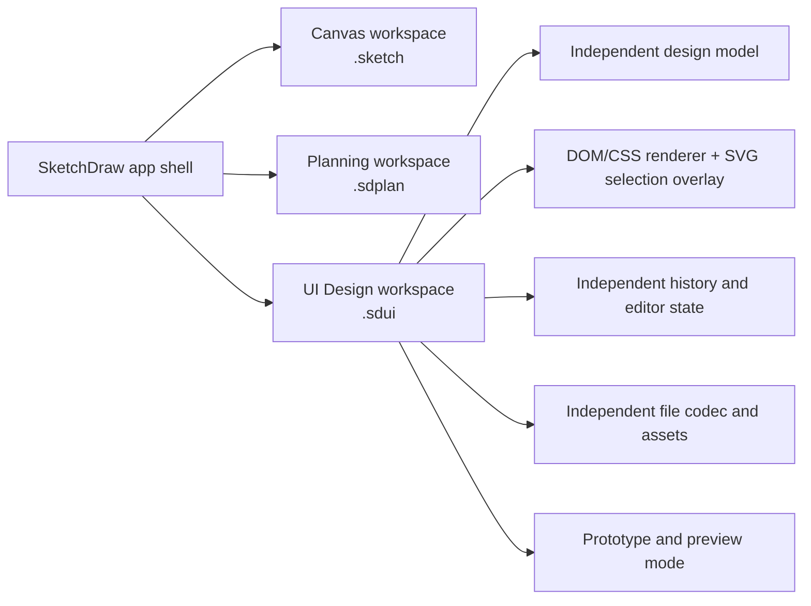

# UI Design workspace: research and development plan

**Status:** Initial independent workspace implemented. This document records the delivered v1 boundary and the next development stages.

This document summarizes the research behind SketchDraw's independent UI Design workspace and its follow-up plan. UI Design is a third top-level viewport alongside Canvas and Planning, with its own editor logic and `.sdui` document format.

## Research findings

- **Build around artboards, reusable components, and variants.** Figma and Penpot both use reusable component definitions with instances that can inherit from a main component while allowing local overrides. Their variable and token systems support shared styles and theme modes. These are useful patterns to study for a UI editor. ([Figma variables](https://help.figma.com/hc/en-us/articles/15339657135383-Guide-to-variables-in-Figma), [Penpot components](https://help.penpot.app/user-guide/design-systems/components/), [Penpot design tokens](https://help.penpot.app/user-guide/design-systems/design-tokens/))
- **Treat responsive layout as a core design feature.** CSS Grid and Flexbox provide two-dimensional and flexible layout, while container queries allow components to respond to the size of their own frame. Fluent 2 and Apple’s guidance emphasize clear hierarchy, consistent spacing, and layouts that adapt to different windows and devices. ([MDN responsive design](https://developer.mozilla.org/en-US/docs/Learn_web_development/Core/CSS_layout/Responsive_Design), [MDN container queries](https://developer.mozilla.org/en-US/docs/Web/CSS/Guides/Containment/Container_queries), [Fluent 2 layout](https://fluent2.microsoft.design/layout), [Apple layout guidance](https://developer.apple.com/design/human-interface-guidelines/layout))
- **Use semantic design tokens and accessibility rules.** Material Design 3 uses semantic color roles. The Design Tokens Community Group has a stable 2025.10 format, though it is a Community Group report rather than a W3C Standard. WCAG 2.2 and the WAI tab pattern provide a basis for accessibility and keyboard behavior. ([Material color roles](https://m3.material.io/m3/pages/color-roles?s=m3), [DTCG format](https://www.w3.org/community/reports/design-tokens/CG-FINAL-format-20251028/), [WCAG 2.2](https://www.w3.org/TR/wcag/), [WAI tabs pattern](https://www.w3.org/WAI/ARIA/apg/patterns/tabs/))
- **Make prototyping and handoff separate modes.** Penpot prototypes connect boards with interactions and flows. Figma Dev Mode and Penpot Inspect focus on exposing measurements, properties, assets, and implementation details. ([Penpot prototyping](https://help.penpot.app/user-guide/prototyping-testing/prototyping/), [Figma Dev Mode](https://help.figma.com/hc/en-us/articles/15023124644247-Guide-to-Dev-Mode-in-Figma))
- **Test components and rendered screens independently.** Storybook supports isolated component states and documentation; Playwright supports screenshot comparisons, with baselines kept on consistent operating systems because browser rendering can vary. ([Storybook](https://storybook.js.org/docs), [Playwright visual comparisons](https://playwright.dev/docs/test-snapshots))

## How this fits SketchDraw

The app shell routes **Canvas**, **Planning**, and **UI Design** independently. When a `.sketch` is open, a second navigation group switches between Canvas and Diagram tools, where “Diagram” refers to the existing canvas diagram workspace. The three workspaces use separate document sessions and formats.

UI Design is a **third top-level workspace**, not another Canvas document view. The existing Canvas diagram view stays distinct so users do not confuse diagram tools with interface design.

## Recommended architecture

The dedicated `src/features/ui-design/` feature owns its document model, DOM renderer, editor state, selection, history, inspector, preview mode, validation, and file codec. It does not reuse Canvas or Planning feature components, data models, geometry, hit-testing, editor interactions, history, or persistence, including the existing Forms & UI canvas components. Only generic application-shell and platform file-access infrastructure is shared.

The app can provide the host-level navigation and native file-picker/filesystem bridge. The UI Design workspace should own its feature behavior and data.

**Recommended rendering approach:** use SolidJS to render design nodes as DOM elements styled with CSS Grid, Flexbox, and container queries; use a separately implemented SVG or DOM overlay for selection handles and guides. This recommendation combines SketchDraw’s existing Solid/Vite stack with the need to design real interface layouts rather than generic diagram objects. Solid’s JSX renders DOM nodes directly, which fits this model. ([SolidJS JSX](https://docs.solidjs.com/concepts/understanding-jsx))

**File extension:** `.sdui`, with the versioned `SketchDrawUIDesign` format. The initial format stores pages, artboards, and bounded UI elements as JSON and validates document size, counts, IDs, numeric bounds, and colors. Parsing and save lifecycle stay separate from the `.sketch` and `.sdplan` codecs. Tauri's native file dialogs and platform document providers handle file access. ([Tauri dialog plugin](https://v2.tauri.app/plugin/dialog/))

### Delivered v1 scope

- Three top-level workspace routes and a nested Canvas / Diagram switch when a sketch is open.
- Independent UI Design model, session, recent-file list, undo/redo, validation, and `.sdui` file handling.
- Pages, named artboards, desktop/tablet/mobile presets, and editable text, button, input, checkbox, card, and image elements.
- Pointer move/resize, duplicate, keyboard nudging, layout grids, grid snapping, smart alignment guides, pointer-centered wheel zoom, fit-to-view, property editing, preview mode, file open/save/save-as, OS file association, and Android document picker support.
- No Canvas feature component, Canvas model, Planning feature component, or `.sketch`/`.sdplan` persistence code is used by the UI Design editor.

This is a screen composition MVP. Reusable components, responsive constraints/layouts, design tokens, clickable prototype flows, and developer handoff are not part of v1 and remain in the next stages below.

## Delivered foundation

The independent UI Design workspace is implemented with its own route, session, model, and `.sdui` codec. It includes pages and artboards, desktop/tablet/mobile presets, editable interface elements, an inspector, undo/redo, and preview mode. The artboard also has configurable column guides, optional 8 px snapping, smart edge/center alignment guides, pointer-centered scroll-wheel zoom, zoom controls, a slider, and fit-to-view.

## Recommended follow-up roadmap

### 1. Better editing and arrangement

- Add multi-selection, align/distribute actions, lock/hide, layer ordering, grouping, and copy/paste.
- Keep pointer hit targets and selection outlines aligned with visible elements at every zoom level.
- Add discoverable keyboard controls for selection, duplication, ordering, and alignment.

### 2. Responsive layout

- Add row, column, and grid containers with gap and padding controls.
- Add fixed, fill, and hug sizing, parent-relative constraints, and viewport previews.
- Define a versioned migration before changing `.sdui` node/layout records.

CSS Grid, Flexbox, and container queries offer useful layout models. ([MDN responsive design](https://developer.mozilla.org/en-US/docs/Learn_web_development/Core/CSS_layout/Responsive_Design), [MDN container queries](https://developer.mozilla.org/en-US/docs/Web/CSS/Guides/Containment/Container_queries))

### 3. Reusable design systems

- Add semantic color, type, and spacing tokens with theme modes.
- Add reusable components, instances, variants, and explicit local overrides.
- Consider DTCG token import/export after the internal model is stable.

Figma and Penpot provide patterns for variables, components, and design tokens. ([Figma variables](https://help.figma.com/hc/en-us/articles/15339657135383-Guide-to-variables-in-Figma), [Penpot components](https://help.penpot.app/user-guide/design-systems/components/), [DTCG format](https://www.w3.org/community/reports/ig/2025/format-20251028/))

### 4. Prototyping and handoff

- Add links between artboards, start points, overlays, and a presentation mode.
- Add PNG, SVG, and PDF exports, followed by an inspect panel for measurements, tokens, and layout properties.
- Consider generated HTML/CSS only after layout behavior is predictable.

Penpot’s flows and overlays and Figma Dev Mode offer relevant interaction and handoff patterns. ([Penpot prototyping](https://help.penpot.org/user-guide/prototyping-testing/prototyping/), [Figma Dev Mode](https://help.figma.com/hc/en-us/articles/15023124644247-Guide-to-Dev-Mode-in-Figma))

### 5. Accessibility and validation

- Add element semantics, contrast checks, focus order, and keyboard-only editing.
- Validate malformed/oversized files, save/reopen, undo/redo, and isolation from Canvas and Planning.
- Keep Android focused on opening, previewing, and simple edits, with advanced controls collapsed.

Use WCAG 2.2 and the WAI tabs pattern as references for accessible controls and navigation. ([WCAG 2.2](https://www.w3.org/TR/WCAG/), [WAI tabs pattern](https://www.w3.org/WAI/ARIA/apg/patterns/tabs/))

Keep direct Figma-file compatibility, collaboration, and broad code generation out of scope unless the product boundary changes.